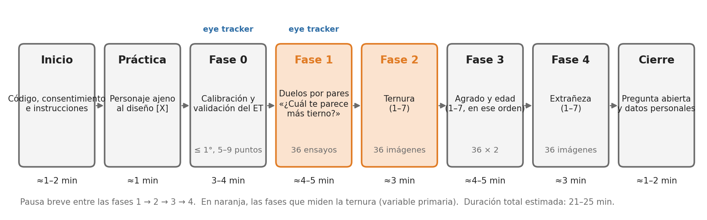
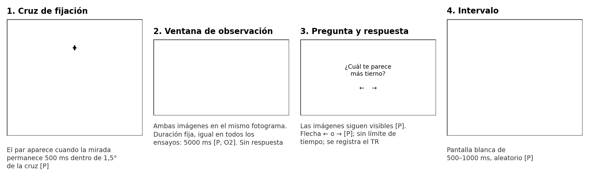
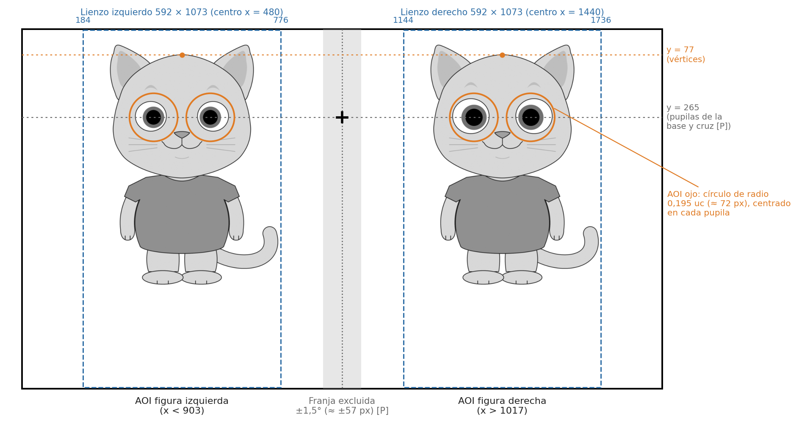

# Mascotas científicas: documento maestro para el desarrollo de la tarea experimental

**Especificación funcional y técnica para la programación de la tarea** · Laboratorio de Neurociencias Cognitivas (Neurolab), Facultad de Psicología, Universidad de Lima

**Investigadora responsable:** Alison Geraldine Quiroz Quispe · **Versión:** 1.0 (fase F10) · 27 de octubre de 2026

**Base:** documento de decisiones F8 v2.0 (20-10-2026), documento de justificación F9 v2 (26-10-2026), script `F8_script_generador_verificador_v2.py`, lista de pares `F8_pares_contexto_base_v2.csv` y decisión del 27-10-2026 sobre el ítem de ternura. **Estado:** especificación para el desarrollo; el estudio aún no se ha aplicado.

## Cómo usar este documento

Este documento reúne lo necesario para programar la tarea: qué ve el participante, en qué orden y con qué tiempos, qué debe registrarse y cómo se comprobará que el programa funciona. No hace falta leer los documentos científicos del proyecto. Cuando una regla responde a una razón metodológica, la razón se explica en una o dos líneas, dado que cambiar la regla sin conocerla podría invalidar los datos.

Cada especificación lleva una etiqueta de estado:

- **[D] Decidido.** Forma parte del diseño aprobado. No se modifica sin autorización de la investigadora.
- **[P] Provisional.** Valor por defecto razonable que puede cambiar tras conocer el equipo o tras las pruebas. Debe implementarse como parámetro configurable, nunca como un valor fijo en el código.
- **[X] Pendiente.** Falta información o una decisión. El programa debe admitirlo por configuración y la investigadora entregará el valor final (§13).

Para empezar, conviene leer el resumen (§1), las reglas que no deben romperse (§2) y la tabla de parámetros (§12).

> **Cambio del 27 de octubre de 2026: el ítem de ternura queda fijado.** No se realizarán entrevistas cognitivas ni ningún piloto o evaluación cualitativa para definir la redacción del ítem de ternura. El enunciado definitivo es «¿Qué tan tierno te parece este personaje?», con una escala de 1 a 7 **[D]**. Esta decisión sustituye la previsión del documento F9 v2 (§2.3, §10 y §11.3), que contemplaba comparar dos o tres redacciones antes de la recogida. Para la programación, el texto es definitivo y debe reproducirse literalmente.

**Otras actualizaciones respecto del documento F8 v2.0 que ya incorpora esta especificación.** (a) La ternura se valora sola en la fase 2, y el agrado y la edad se valoran juntos, en ese orden, en la fase 3 (decisión del 22-10-2026). (b) No habrá piloto de calibración psicofísica de los niveles (decisión del 22-10-2026). (c) Los códigos de las condiciones son los del script de generación (Anexo E).

## 1. Resumen del estudio y de la tarea

**Qué se estudia.** Cómo tres cambios en el dibujo de un gato antropomórfico modifican la ternura que percibe un observador: el tamaño de los ojos (factor A), la altura de los ojos dentro de la cabeza (factor B) y la longitud del cuerpo con la cabeza idéntica (factor C). La ternura percibida es la variable principal; asimismo, se miden la edad aparente, el agrado, la extrañeza y la mirada.

**Qué hay que programar.** Una sesión individual de laboratorio de 21 a 25 minutos, con un *eye tracker* de barra, compuesta por:

1. Calibración y validación del *eye tracker*.
2. Treinta y seis «duelos»: dos versiones del gato en pantalla, una a cada lado; se registra la mirada y el participante elige cuál le parece más tierna.
3. Tres bloques de valoraciones: las 36 imágenes, una a una, valoradas de 1 a 7 (primero ternura; después agrado y edad; por último extrañeza).
4. Preguntas finales.

**Datos por participante.** 36 elecciones, 144 valoraciones (36 de ternura, 36 de agrado, 36 de edad y 36 de extrañeza), el registro ocular de los 36 duelos y las respuestas del cierre.

**Estímulos.** Treinta y seis imágenes PNG ya diseñadas y verificadas por código. El programa solo las presenta: no las genera ni las modifica. Las imágenes definitivas se exportarán después de la revisión visual (§4.5); mientras tanto, el desarrollo puede avanzar con versiones de prueba.

**Figura 1**

*Flujo de la sesión*

{width=16.5cm}

*Nota.* Duraciones estimadas a partir de los documentos F8 v2.0 y F9 v2; deben medirse en las pruebas (§11). La ubicación de la práctica antes de la calibración es provisional [P].

## 2. Reglas que no deben romperse

Estas reglas protegen la validez de los datos. Si alguna resulta difícil de cumplir con el software o el equipo disponibles, debe consultarse con la investigadora antes de buscar una alternativa.

1. **Las imágenes se muestran tal como se entregan [D].** Sin reescalar, recortar, comprimir, suavizar ni cambiar el color: un píxel de la imagen equivale a un píxel de la pantalla. *Por qué:* las dos imágenes de un par difieren en un solo rasgo, a veces en unos 11 píxeles; por consiguiente, cualquier transformación puede introducir diferencias que no forman parte del diseño. Si el monitor exige otro tamaño, las imágenes se regeneran con el script a la escala adecuada (§5); nunca se reescalan en el programa.
2. **Alineación por el vértice de la cabeza [D].** Todas las imágenes comparten el mismo lienzo y, en él, el vértice de la cabeza ocupa siempre la misma posición. Por lo tanto, basta con colocar el lienzo siempre en la misma posición de pantalla dentro de cada fase y, en los duelos, a la misma altura en ambos lados. Nunca se centra una figura según su altura o su contorno. *Por qué:* la cabeza no debe moverse entre el cuerpo base y el cuerpo alargado.
3. **El orden de las fases es fijo [D]:** calibración → duelos → ternura → agrado y edad → extrañeza → cierre. No se contrabalancea entre participantes. *Por qué:* cada tarea va antes de las que podrían contaminarla. La mirada se registra cuando las imágenes todavía son nuevas, dado que el patrón de exploración cambia con la familiaridad (Althoff y Cohen, 1999), y la ternura se valora antes que cualquier otra escala, porque unos juicios influyen en otros (Kuraguchi et al., 2015) y preguntar por la edad podría revelar la hipótesis (Corneille y Lush, 2023).
4. **Ninguna imagen experimental aparece antes de la fase 1 [D]:** tampoco en instrucciones, práctica o pantallas de ejemplo.
5. **Cada par crítico se presenta dos veces, una con cada imagen a la izquierda [D].** *Por qué:* la exploración visual comienza con un sesgo hacia la izquierda (Ossandón et al., 2014); al invertir los lados, ese sesgo se reparte por igual entre las dos versiones.
6. **Los textos de los ítems se reproducen literalmente [D]** (§7). No se resumen, traducen ni reformulan.
7. **Sin retroalimentación [D].** No se indica si una respuesta es «correcta», ni se muestran al participante códigos, nombres de archivo o números de condición.
8. **Fondo blanco idéntico al de las imágenes** en todas las pantallas con estímulos, y **luminancia de la sala constante [D].**
9. **Aleatorización nueva para cada participante, con semilla registrada [D]** (§8).
10. **Cada respuesta se guarda en cuanto se produce [D]** (§10), de modo que una interrupción no haga perder los datos ya recogidos.

## 3. Términos que usa este documento

**Tabla 1**

*Glosario mínimo*

| Término | Significado |
|----------|---------------------------------------------|
| uc (unidad de cabeza) | Altura de la cabeza, desde el vértice del cráneo (sin orejas) hasta el mentón. Las medidas geométricas se expresan en uc; con la escala provisional, 1 uc = 370 px. |
| Vértice (V) | Punto más alto del cráneo en la línea media, sin contar las orejas. Es el punto de alineación de todas las imágenes. |
| Identidad | Cada uno de los dos gatos (ID1 e ID2). Comparten la cabeza, los rasgos faciales y el cuerpo, y difieren en las orejas y en sus marcas. |
| Base | Versión sin modificar de cada identidad: `ID1-OJmae-PObas-CUbas` e `ID2-OJmae-PObas-CUbas`. |
| Par mínimo | Dos imágenes de la misma identidad que difieren en un solo rasgo. |
| Duelo | Ensayo de la fase 1: dos imágenes a la vez, una a cada lado. |
| Lienzo | Rectángulo completo de la imagen PNG (592 × 1073 px con la escala provisional), incluido el fondo blanco. |
| AOI (área de interés) | Región de la pantalla en la que se cuenta la mirada durante el análisis. |
| Ventana de observación | Intervalo fijo, igual en todos los duelos, durante el cual se muestran las imágenes antes de pedir la respuesta. |
| TR | Tiempo de respuesta, medido desde la aparición de la pregunta. |
| ET | *Eye tracker* (sistema de seguimiento ocular). |

## 4. Estímulos

### 4.1. Diseño de las 36 imágenes

El diseño es factorial: se cruzan tres tamaños de ojo, tres alturas de ojo y dos longitudes de cuerpo (3 × 3 × 2 = 18 condiciones) en dos identidades, lo que da 36 imágenes **[D]**. Cada participante ve todas las imágenes.

**Tabla 2**

*Factores, niveles y códigos*

| Factor | Qué cambia | Niveles: código y valor |
|------------|------------------------|----------------------------|
| A. Tamaño ocular | El ojo completo (contorno, esclerótica, iris y pupila) se escala alrededor del centro de la pupila; la ceja lo acompaña | `OJpeq`: s = 0,850 · `OJmae`: s = 1,000 (base) · `OJgra`: s = 1,176 |
| B. Posición vertical de los ojos | Ojos y cejas suben o bajan dentro de una cabeza que no cambia | `POsub`: yP = 0,478 uc · `PObas`: yP = 0,508 uc (base) · `PObaj`: yP = 0,538 uc |
| C. Proporción cabeza-cuerpo | Se alarga el cuerpo; la cabeza es idéntica píxel a píxel | `CUbas`: R = 1,862 (base) · `CUlar`: R = 2,500 |
| Identidad | Orejas y marcas (ID2 tiene rayas en la frente, hocico claro y anillos en la cola) | `ID1` · `ID2` |

*Nota.* s es el factor de escala del ojo; yP, la altura del centro de las pupilas medida desde el vértice; R, la altura total de la figura (del vértice al apoyo de los pies) dividida por la altura de la cabeza. Fuente: documento F8 v2.0 y script de generación.

**Código de condición.** Identidad, ojo, posición y cuerpo, separados por guiones: `ID1-OJmae-PObas-CUbas` es la base de ID1. El Anexo A lista las 18 condiciones de cada identidad.

**Magnitud de los cambios.** Las diferencias son deliberadamente pequeñas. Al cambiar el tamaño, la superficie del ojo pasa a 0,72 o a 1,38 veces la original; al cambiar la altura, los ojos se desplazan unos 11 px; al alargar el cuerpo, la figura crece un 33 % hacia abajo. Esta es la razón principal de la regla 1 (§2).

### 4.2. Archivos y manifiesto

- **Formato [D]:** PNG sin pérdida, en escala de grises con paleta fija y fondo blanco (#FFFFFF).
- **Tamaño [P]:** 592 × 1073 px, que corresponde a una altura de cabeza de 370 px (`h_px` = 370). El valor es provisional hasta conocer el monitor (§5).
- **Nombre de archivo [D]:** `MCv2_<identidad>_OJ<nivel>_PO<nivel>_CU<nivel>_v<n>.png`; por ejemplo, `MCv2_ID1_OJmae_PObas_CUbas_v1.png`. El programa obtiene el código de condición a partir del nombre (sustituye los guiones bajos por guiones y quita el prefijo y la versión).
- **Origen [D]:** el script genera las 36 plantillas SVG (opción `--plantillas`), la investigadora las exporta a PNG en Affinity y el script verifica las exportaciones (opción `--medir_png`, que produce `F8_verificacion_png_v2.csv`). El ingeniero no genera ni edita imágenes.
- **Manifiesto [P]:** el programa lee un archivo `estimulos_manifiesto.csv` con una fila por imagen y las columnas `codigo`, `archivo`, `identidad`, `OJ`, `PO`, `CU`, `s`, `yP_uc`, `R`, `ancho_px`, `alto_px`, `h_px` y `sha256`. Al iniciar, calcula la huella SHA-256 de cada archivo y se detiene con un mensaje claro si falta alguno o si una huella no coincide. *Por qué:* así se evita aplicar una sesión con una versión equivocada de las imágenes.

### 4.3. Geometría del lienzo

Las coordenadas siguientes sirven para colocar las imágenes y, después, para calcular las áreas de interés. Se expresan en píxeles del lienzo, con el origen en su esquina superior izquierda y el eje y hacia abajo.

**Tabla 3**

*Puntos de referencia del lienzo*

| Punto | Fórmula general | Valor con h_px = 370 |
|-------------------|----------------------------|---------------------|
| Tamaño del lienzo | 1,6·h_px × 2,9·h_px | 592 × 1073 px |
| Vértice V (línea media de la figura) | (0,8·h_px; 0,2·h_px) | (296; 74) |
| Conversión de uc a píxeles | x = 0,8·h_px + x_uc·h_px; y = 0,2·h_px + y_uc·h_px | x = 296 + 370·x_uc; y = 74 + 370·y_uc |
| Centros de las pupilas (x) | 0,8·h_px ± 0,230·h_px | 210,9 y 381,1 |
| Centros de las pupilas (y) | 0,2·h_px + yP·h_px | 250,9 (POsub); 262,0 (PObas); 273,1 (PObaj) |
| Mentón | 1,2·h_px | 444 |
| Apoyo de los pies | 0,2·h_px + R·h_px | 763 (CUbas); 999 (CUlar) |

*Nota.* Los centros de las pupilas no cambian con el tamaño ocular (A), porque el ojo se escala alrededor de la pupila; solo cambian con la posición (B). La cola se extiende hacia la derecha hasta x ≈ 584, de modo que la figura no es simétrica: se centra el lienzo, nunca la figura. Valores derivados del script de generación y comprobados en una representación de prueba.

### 4.4. Estímulos de práctica

La práctica no debe usar imágenes experimentales (regla 4). Se necesita un personaje ajeno al diseño, con el mismo estilo y el mismo tamaño de lienzo **[X]**; la investigadora lo proporcionará. El programa debe cargarlo desde una carpeta propia (`estimulos/practica/`).

### 4.5. Estado actual de los estímulos

- Las 36 condiciones superaron la verificación automática por código (fase F8).
- Las imágenes definitivas **todavía no se han exportado**. Antes faltan la revisión visual de las láminas, la decisión sobre el hocico claro de ID2 (O6), la unificación final de la nomenclatura y, posiblemente, el ajuste de `h_px` al monitor real (O10).
- **Para el desarrollo** se usará un conjunto provisional de 36 PNG generado con el script, con los mismos nombres y el mismo tamaño. Cuando lleguen las imágenes definitivas, bastará con sustituir los archivos y el manifiesto, y repetir las pruebas 1 a 3 del §11.

## 5. Equipo y entorno de presentación

**Tabla 4**

*Requisitos del equipo y del entorno*

| Elemento | Especificación | Estado |
|----------------|--------------------------------------------|--------|
| *Eye tracker* | De barra (remoto, montado bajo el monitor), del Neurolab. Faltan el modelo, la frecuencia de muestreo, la exactitud nominal y el SDK (O10). | [X] |
| Monitor | Resolución nativa, frecuencia de refresco y tamaño físico por confirmar (O10). Supuesto de trabajo: 1920 × 1080 px, con píxeles de 0,275 mm. | [X] / [P] |
| Distancia de visión | Por confirmar (O10). Supuesto de trabajo: 600 mm. | [X] / [P] |
| Soporte de cabeza | Mentonera durante la calibración y los duelos. | [D] |
| Iluminación | Constante entre sesiones; sin luz directa sobre la pantalla. | [D] |
| Escalado del sistema operativo | 100 % (sin escalado HiDPI o Retina). Debe comprobarse que 1 píxel de imagen = 1 píxel físico. | [D] |
| Modo de presentación | Pantalla completa, sin barras ni ventanas; cursor oculto en las fases 0 y 1. | [P] |
| Software | Elección del ingeniero, compatible con el SDK del equipo. Debe permitir: sincronización con el refresco de pantalla, marcas de evento sincronizadas con el registro ocular, exportación de muestras crudas y aleatorización con semilla. Son opciones habituales PsychoPy, OpenSesame (con PyGaze) o el software del fabricante, si cumple estos requisitos. | [P] |

**Altura de pantalla.** Con un monitor de 1080 px de alto, el lienzo (1073 px) ocupa casi toda la altura; por eso, ningún texto puede colocarse por encima o por debajo de las imágenes en los duelos (§7.4). Si el monitor tuviera menos de 1073 px de alto, o si se quisiera otra escala, las imágenes se regenerarían con un `h_px` menor desde el script **[D]**.

**Conversión a grados de ángulo visual.** Muchas especificaciones se expresan en grados. Para convertirlas: píxeles por grado = distancia (mm) × tan(1°) / tamaño del píxel (mm). Con los supuestos de trabajo (600 mm y 0,275 mm), 1° ≈ 38 px; la cabeza (370 px) subtiende unos 9,7° y el desplazamiento de los ojos en el factor B (11 px), unos 0,29°. Todos estos valores deben recalcularse con el equipo real **[P]**.

## 6. Flujo de la sesión

**Tabla 5**

*Secuencia de la sesión*

| Momento | Qué hace el participante | Respuestas | Duración aprox. | Registro ocular |
|-------------|--------------------------------|------------|------------|-----------|
| Inicio | Código de participante (lo introduce la persona experimentadora), consentimiento e instrucciones generales | – | 1–2 min | No |
| Práctica [P] | Dos duelos y dos valoraciones con un personaje ajeno al diseño | 4 | ≈ 1 min | No |
| Fase 0 | Calibración y validación del *eye tracker* | – | 3–4 min | Sí |
| Fase 1 | Duelos por pares | 36 elecciones | ≈ 4–5 min | Sí |
| Pausa | Breve, a ritmo del participante | – | – | No |
| Fase 2 | Ternura, imagen por imagen | 36 | ≈ 3 min | No |
| Pausa | Breve | – | – | No |
| Fase 3 | Agrado y edad, imagen por imagen | 72 (36 × 2) | ≈ 4–5 min | No |
| Pausa | Breve | – | – | No |
| Fase 4 | Extrañeza, imagen por imagen | 36 | ≈ 3 min | No |
| Cierre | Pregunta abierta y datos personales | – | 1–2 min | No |

*Nota.* Total estimado: 21 a 25 min. Las duraciones de las fases proceden del documento F8 v2.0, reasignadas al orden actual en F9 v2. Con los tiempos provisionales del §7.4, cada duelo dura unos 8 s (≈ 1 s de cruz, 5 s de observación, ≈ 1,5 s de respuesta y ≈ 0,75 s de intervalo), de modo que la fase 1 dura unos 5 min, algo más que los 4 min estimados en F8. Si la sesión supera los 25 min, el primer parámetro que se revisará será la duración de la ventana de observación (O2).

## 7. Especificación de cada fase

### 7.1. Inicio

- **Pantalla de la persona experimentadora [P]:** código de participante (formato `P001`), número de sesión, modo (real, prueba o automático; §11.1) y confirmación de que el equipo está conectado.
- **Datos personales [D]:** los archivos de la tarea solo contienen el código de participante; nunca nombres ni otros datos identificativos.
- **Consentimiento [X]:** depende de la consulta al comité de ética. Si es digital, la tarea registra la aceptación con fecha y hora y no continúa sin ella; si es en papel, la pantalla de inicio solo pide confirmar que se firmó.
- **Instrucciones generales:** borrador en el Anexo D.

### 7.2. Práctica [P]

- **Objetivo:** que el participante entienda el duelo y la escala sin ver imágenes experimentales (regla 4).
- **Contenido sugerido:** dos duelos y dos valoraciones de 1 a 7 con el personaje de práctica (§4.4), sin registro ocular y sin retroalimentación.
- **Ubicación sugerida:** antes de la calibración, para que la fase 1 comience justo después de validarla. *Por qué:* los duelos son el bloque que más depende de la exactitud del registro.

### 7.3. Fase 0: calibración y validación

- **Procedimiento [D]:** calibración de 5 a 9 puntos con la mentonera colocada y validación posterior.
- **Criterio de aceptación [D]:** error medio de la validación de 1° o menos.
- **Intentos [P]:** hasta dos. Si no se alcanza el criterio, el participante completa la sesión entera, pero se registra `et_valido = 0` y no aporta datos de mirada. Sus elecciones y valoraciones siguen siendo válidas.
- **Registro por intento:** fecha y hora, número de puntos, error medio y error máximo (exactitud), precisión entre muestras si el SDK la ofrece, ojo u ojos registrados y resultado.
- **Transición:** la fase 1 comienza inmediatamente después de una validación aceptada, solo con su instrucción breve.

### 7.4. Fase 1: duelos por pares

**Composición (36 ensayos) [D].** La lista completa, antes de aleatorizar, está en el Anexo B.

- **28 ensayos críticos:** 14 pares mínimos (7 por identidad), cada uno presentado dos veces, una con cada imagen a la izquierda. Por identidad, el factor A aporta tres pares (pequeños frente a base, base frente a grandes y pequeños frente a grandes); el factor B, otros tres (subidos frente a base, base frente a bajados y subidos frente a bajados), y el factor C, uno (base frente a alargado). Cinco de los siete pares incluyen la base y dos comparan los extremos de un mismo rasgo.
- **4 ensayos idénticos:** la misma imagen en ambos lados. Sirven para estimar la tendencia a elegir un lado cuando no hay diferencia real. Composición por defecto **[P]**: la base de ID1 en dos ensayos y la base de ID2 en dos ensayos.
- **4 ensayos de relleno:** una imagen de ID1 frente a una de ID2. Rompen la sucesión de pares casi idénticos y reducen la búsqueda deliberada de diferencias; no se analizan, aunque se registran por completo. Composición por defecto **[P]**: base de ID1 frente a base de ID2, y cuerpo alargado de ID1 frente a cuerpo alargado de ID2, cada par con ambas disposiciones de lado.

**Secuencia de un ensayo (Figura 2).**

1. **Cruz de fijación.** Se dibuja en el centro horizontal de la pantalla. Altura por defecto **[P]**: la de las pupilas de la base (y ≈ 265 px con la disposición de la Figura 3), según la propuesta del documento maestro; la alternativa es el centro vertical de la pantalla (§13). Control de fijación **[P]**: el par aparece cuando la mirada permanece 500 ms dentro de 1,5° de la cruz. Si no se logra en 5 s, cuenta como un intento fallido; tras tres intentos fallidos consecutivos, el programa ofrece recalibrar mediante una tecla de la persona experimentadora. Sin datos oculares válidos o en modo de prueba, la cruz se muestra durante 1000 ms fijos.
2. **Ventana de observación.** Las dos imágenes aparecen en el mismo fotograma y a la misma altura (regla 2). La ventana tiene una duración fija, igual en todos los ensayos **[D]**; valor por defecto, 5000 ms **[P]** (decisión O2). Durante la ventana no se aceptan respuestas; las pulsaciones se registran como prematuras **[P]**. *Por qué:* durante una decisión, la mirada tiende a desplazarse hacia la opción que se elegirá y, a la vez, influye en la elección (Shimojo et al., 2003; Krajbich et al., 2010). Una ventana igual para todos hace comparables los ensayos.
3. **Pregunta y respuesta.** Al terminar la ventana aparece «¿Cuál te parece más tierno?» **[D]**, con el recordatorio de las teclas, en la franja central entre las dos imágenes **[P]**. Las imágenes siguen visibles hasta la respuesta **[P]**. Respuesta con la flecha izquierda o derecha **[P]**, sin límite de tiempo **[P]**; el TR se mide desde la aparición de la pregunta.
4. **Intervalo.** Pantalla blanca de 500 a 1000 ms, con duración aleatoria uniforme **[P]**.

**Figura 2**

*Secuencia de un ensayo de duelo*

{width=16.5cm}

*Nota.* Ilustración con la base de ID1 a la izquierda y la variante de ojos grandes a la derecha (par C03). Las imágenes se generaron con el script del proyecto solo para ilustrar; no son los estímulos definitivos.

**Disposición en pantalla [P].** Con un monitor de 1920 × 1080 px, los lienzos se colocan con sus centros en x = 480 y x = 1440 (es decir, a 480 px a cada lado del centro) y su borde superior en y = 3; así, los vértices quedan en y = 77 en ambos lados (Figura 3). El criterio general es la simetría respecto del centro horizontal y la misma altura en ambos lados; las coordenadas concretas se recalculan para el monitor real.

**Figura 3**

*Disposición de la pantalla en los duelos y áreas de interés*

{width=16cm}

*Nota.* Ejemplo con un monitor de 1920 × 1080 px y h_px = 370. Las líneas discontinuas azules marcan los lienzos; los círculos naranjas, las AOI de los ojos, y la banda gris, la franja central excluida de las AOI de figura. La conversión de grados a píxeles usa los supuestos de trabajo del §5.

**Instrucción del bloque.** No debe mencionar los ojos, el cuerpo ni las diferencias entre las imágenes, ni sugerir que se busquen (borrador en el Anexo D) **[D]**.

### 7.5. Fase 2: ternura

- **Presentación [D]:** las 36 imágenes, de una en una, en un orden aleatorio nuevo.
- **Ítem [D, fijado el 27-10-2026]:** «¿Qué tan tierno te parece este personaje?»
- **Escala [D]:** de 1 a 7. Anclas por defecto **[P]**: 1 = «Nada tierno» y 7 = «Muy tierno», con los siete números visibles y sin etiquetas intermedias.
- **Respuesta [P]:** clic en la escala de la pantalla o teclas del 1 al 7. Se registran el valor y el TR, medido desde la aparición de la imagen.
- **Tiempo [P]:** la imagen permanece visible hasta la respuesta, sin límite; después, 500 ms de pantalla blanca.
- **Disposición [P]:** el lienzo ocupa siempre la misma posición (por ejemplo, centrado en x = 640 y con su borde superior en y = 3), y la pregunta y la escala se sitúan a su derecha, sin superponerse a él. La misma disposición se usa en las fases 2, 3 y 4.
- **Registro ocular:** no se requiere en las fases 2 a 4.

### 7.6. Fase 3: agrado y edad

- **Presentación [D]:** las 36 imágenes, de una en una, en un orden aleatorio nuevo.
- **Dos preguntas por imagen, en orden fijo [D]:** primero el agrado y después la edad. La imagen permanece visible durante ambas; la segunda pregunta aparece al responder la primera **[P]**.
  - **Agrado [D]:** «¿Cuánto te gusta este personaje?», de 1 a 7. Anclas por defecto **[P]**: 1 = «No me gusta nada» y 7 = «Me gusta mucho».
  - **Edad [D]:** escala de 1 a 7, de «Cría» (1) a «Adulto» (7). Enunciado por defecto **[P]**: «¿Qué edad aparenta este personaje?».
- **Opción de contrabalanceo [P]:** prever un parámetro que permita alternar el orden agrado → edad entre participantes, desactivado por defecto. *Por qué:* es una alternativa que la supervisión podría preferir; el diseño actual mantiene el orden fijo.

### 7.7. Fase 4: extrañeza

- **Presentación [D]:** las 36 imágenes, de una en una, en un orden aleatorio nuevo.
- **Ítem [D]:** «¿Qué tan raro o inquietante te parece este personaje?», de 1 a 7. Anclas por defecto **[P]**: 1 = «Nada raro o inquietante» y 7 = «Muy raro o inquietante».
- *Por qué al final:* preguntar por lo raro invita a buscar defectos; situada al final, esta pregunta no puede influir en las demás.

### 7.8. Pausas [P]

Entre las fases 1 y 2, 2 y 3, y 3 y 4 se muestra: «Puedes descansar unos segundos. Pulsa la barra espaciadora cuando quieras continuar». Se registra la duración de cada pausa.

### 7.9. Cierre

1. **Pregunta abierta [D]**, con respuesta de texto libre: «¿Notaste algo especial en los personajes? ¿En qué se diferenciaban?». Debe ir antes que los datos personales. *Por qué:* permite repetir los análisis sin las personas que detectaron las manipulaciones.
2. **Datos para análisis exploratorios [D]:** edad, género, convivencia con gatos, actitud hacia los gatos, familiaridad con este estilo de dibujo y lateralidad manual. El texto exacto y las opciones de respuesta están pendientes **[X]**; el módulo debe leerlos de un archivo de configuración.
3. **Agradecimiento** y fin de la sesión.

## 8. Aleatorización y control del orden

### 8.1. Fase 1

Cada uno de los 36 ensayos tiene un identificador (`ensayo_id`) y pertenece a un par (`par_id`); los dos ensayos de un mismo par comparten `par_id` (Anexo B). Para cada participante se genera un orden nuevo que cumpla dos restricciones **[D]**:

1. **El mismo par no aparece en ensayos consecutivos**, en ninguna de sus dos disposiciones de lado.
2. **No hay más de tres ensayos seguidos de la misma identidad.** Los ensayos críticos e idénticos pertenecen a ID1 o a ID2; los de relleno cuentan como «mixtos» e interrumpen la racha.

**Algoritmo sugerido [P]:** barajar la lista con el generador inicializado por la semilla, comprobar las restricciones y repetir hasta cumplirlas (muestreo con rechazo), con un límite de intentos y un aviso si se alcanza. Se registra el número de intentos.

### 8.2. Fases 2, 3 y 4

Orden aleatorio independiente para cada fase y cada participante **[D]**, sin restricciones adicionales **[P]**.

### 8.3. Semilla y reproducibilidad

Al iniciar la sesión se genera una semilla que se registra en los metadatos **[D]**. Con la misma semilla y la misma versión del programa, los órdenes de las cuatro fases y los intervalos aleatorios deben reproducirse exactamente **[P]**. Los órdenes generados se guardan también como listas explícitas en los metadatos.

### 8.4. Covariables de orden

Para cada respuesta se registran el número de ensayo global y el número de ensayo dentro de la fase **[D]**. *Por qué:* el análisis usa el número de ensayo como covariable para controlar la fatiga.

## 9. Registro ocular

### 9.1. Qué se registra

- **Muestras crudas [D]** de toda la fase 1, desde la primera cruz de fijación hasta la última respuesta: marca temporal del equipo, marca temporal del programa, coordenadas de la mirada en píxeles de pantalla (cada ojo y promedio), validez por ojo y tamaño pupilar, si el equipo lo proporciona **[P]**.
- **Frecuencia de muestreo:** la nominal del equipo, que se registra **[X]**.
- **Fijaciones:** si el software del equipo las calcula, se exportan también y se registran el algoritmo y sus parámetros. Los parámetros se fijan antes de recoger datos **[D]**; de todos modos, las muestras crudas permiten recalcularlas en el análisis.
- **Calibración:** resultados de cada intento (§7.3).

### 9.2. Marcas de evento

Cada evento se registra con la marca temporal del programa y su equivalente en el reloj del equipo, sincronizados según el método del SDK **[D]**. La marca de aparición del par debe corresponder al fotograma en que las imágenes se muestran realmente (momento del cambio de fotograma), no al momento en que se ordena dibujarlas; error máximo admisible: un fotograma **[P]**.

**Tabla 6**

*Marcas de evento de la fase 1*

| Evento | Cuándo se registra | Datos asociados |
|------------------|-----------------------------------|-----------------------------------|
| `FASE1_INICIO` / `FASE1_FIN` | Inicio y fin del bloque | Validación aceptada (sí o no) |
| `ENSAYO_INICIO` | Antes de la cruz | `n_global`, `ensayo_id`, `par_id`, imágenes izquierda y derecha |
| `CRUZ_ON` | Aparición de la cruz | Posición de la cruz |
| `FIJACION_OK` / `FIJACION_FALLO` | Fijación lograda o intento fallido | Número de intento |
| `RECALIBRACION` | Si se recalibra durante el bloque | Resultado |
| `PAR_ON` | Fotograma en que aparecen las imágenes | Posición de ambos lienzos |
| `RESPUESTA_PREMATURA` | Pulsación durante la ventana | Tecla |
| `VENTANA_FIN` / `PREGUNTA_ON` | Fin de la ventana y aparición de la pregunta | Duración real de la ventana |
| `RESPUESTA` | Pulsación válida | Lado elegido, código de la imagen elegida, TR |
| `PAR_OFF` / `ITI_ON` | Desaparición de las imágenes e inicio del intervalo | Duración del intervalo |

### 9.3. Áreas de interés

Las AOI se calculan en el análisis, no en el programa; sin embargo, el programa debe registrar todo lo necesario para calcularlas: la resolución de pantalla, `h_px`, la posición de la esquina superior izquierda de cada lienzo en cada ensayo y la posición de la cruz **[D]**.

- **Nivel figura (principal) [D]:** cada mitad de la pantalla, separada por la vertical central, sin una franja alrededor de la cruz de fijación. Anchura por defecto de la franja **[P]**: 1,5° a cada lado (≈ 57 px con los supuestos de trabajo). Las AOI grandes de este tipo son las más robustas al ruido de la señal en estímulos con caras (Hessels et al., 2016).
- **Nivel ojos (exploratorio) [D]:** un círculo de radio fijo de 0,195 uc (≈ 72 px con h_px = 370), centrado en cada pupila de cada figura. El radio es igual en los tres tamaños de ojo y el círculo se desplaza con la posición de los ojos. Los centros se obtienen del manifiesto y de la posición del lienzo (Tabla 3). *Por qué fijo:* si el área siguiera el contorno del ojo, un ojo grande recibiría más mirada solo por ocupar más superficie.

### 9.4. Calidad de los datos

Criterios propuestos en F9 v2 **[P]**, que se aplican en el análisis; el programa solo calcula y guarda los indicadores:

- **Ensayo válido:** fijación inicial lograda en la cruz, al menos un 50 % de muestras válidas en la ventana de observación y al menos una fijación en una AOI de figura. El programa guarda, por ensayo, el porcentaje de muestras válidas en la ventana.
- **Participante sin datos de mirada:** menos de un 60 % de ensayos válidos o calibración no lograda tras dos intentos.
- **Informe:** el estudio seguirá la guía mínima de informe para investigaciones con seguimiento ocular de Dunn et al. (2024). Por ello, los metadatos deben incluir el fabricante y el modelo del equipo, el software y su versión, la frecuencia de muestreo, el método y los resultados de la calibración, la distancia de visión y las características del monitor.

## 10. Datos de salida

### 10.1. Archivos por sesión

Cada sesión crea una carpeta propia, por ejemplo `datos/P001_S1_20261105_1030/`, con los archivos de la Tabla 7 **[P]**. Formato por defecto: CSV en UTF-8, separador coma, punto decimal y tiempos en milisegundos desde el inicio de la sesión (y, en las muestras oculares, también en el reloj del equipo).

**Tabla 7**

*Archivos de salida de cada sesión*

| Archivo | Contenido | Cuándo se escribe |
|------------------------|------------------------------------------|---------------------|
| `P001_S1_sesion.json` | Metadatos: versión y *commit* del programa, fecha y hora, modo, semilla, órdenes generados, pantalla, distancia, `h_px`, posiciones de los lienzos y de la cruz, equipo de seguimiento ocular, calibraciones, `et_valido`, duraciones de fase, pausas e interrupciones | Al inicio, y se actualiza al final de cada fase |
| `P001_S1_respuestas.csv` | Una fila por respuesta de todas las fases (formato largo; Anexo C) | Tras cada respuesta |
| `P001_S1_eventos.csv` | Marcas de evento (Tabla 6) | Tras cada evento |
| `P001_S1_mirada.csv` | Muestras crudas del *eye tracker* durante la fase 1 (o el archivo nativo del fabricante y su conversión) | En continuo, con guardado periódico |
| `P001_S1_cierre.csv` | Pregunta abierta y datos personales | Al final |
| `P001_S1_registro.txt` | Avisos, errores e interrupciones | En continuo |

### 10.2. Robustez [P]

- Cada respuesta se escribe y se vuelca a disco antes del ensayo siguiente.
- Si el programa se interrumpe, los datos previos quedan intactos y la interrupción se registra. El programa puede ofrecer reanudar desde el último ensayo completado, con el mismo orden y la misma semilla; la decisión de reanudar o descartar la sesión corresponde a la investigadora.
- Se recomienda una copia de seguridad de la carpeta de datos al final de cada jornada, según las normas del laboratorio.

## 11. Modos de ejecución y pruebas de aceptación

### 11.1. Modos [P]

- **Real:** con el *eye tracker* y las imágenes definitivas.
- **Prueba:** sin *eye tracker*; el ratón simula la mirada. Produce archivos con la misma estructura, marcados como `modo = prueba`.
- **Automático:** un respondedor simulado completa la sesión entera, con respuestas aleatorias y tiempos acortados si se desea, para comprobar la aleatorización y los archivos de salida.

### 11.2. Pruebas de aceptación

Antes de la recogida de datos, el programa debe superar estas pruebas con personal del laboratorio. Las pruebas 1 a 3 se repiten cada vez que se sustituyen las imágenes.

**Tabla 8**

*Pruebas de aceptación*

| N.º | Prueba | Criterio de aceptación |
|----|-------------------------|------------------------------------------|
| 1 | Integridad de los estímulos | Están los 36 archivos; las huellas SHA-256 coinciden con el manifiesto; el tamaño es el esperado |
| 2 | Presentación 1:1 | En una captura de pantalla de un ensayo, la región de cada lienzo coincide píxel a píxel con su PNG (diferencia nula) |
| 3 | Alineación | Los vértices quedan a la misma altura en ambos lados y entre los cuerpos base y alargado |
| 4 | Composición de la fase 1 | 36 ensayos: 28 críticos (cada par crítico exactamente una vez con cada disposición de lado), 4 idénticos y 4 de relleno |
| 5 | Restricciones de orden | En 10 000 órdenes simulados, ninguna infracción de las reglas del §8.1 |
| 6 | Fases 2 a 4 | Cada imagen aparece exactamente una vez por fase; en la fase 3, dos respuestas por imagen, en el orden agrado → edad |
| 7 | Textos | Coincidencia literal con el §7 y con el archivo de textos aprobado |
| 8 | Temporización | La ventana de observación dura el valor configurado ± 1 fotograma en al menos el 99 % de los ensayos (según el registro de fotogramas); los intervalos quedan dentro de su rango |
| 9 | Sincronización | Las marcas de evento quedan alineadas con el registro ocular; si se dispone de un fotodiodo, el desfase entre `PAR_ON` y la aparición real no supera un fotograma |
| 10 | Respuestas prematuras | Las pulsaciones durante la ventana no terminan el ensayo y quedan registradas |
| 11 | Calibración fallida | La sesión continúa y se registra `et_valido = 0` |
| 12 | Interrupción | Tras forzar un cierre a mitad de una fase, los datos previos están completos y la interrupción consta en el registro |
| 13 | Archivos de salida | Tras una sesión completa en modo automático, `respuestas.csv` tiene 180 filas experimentales (36 + 36 + 72 + 36), más las de práctica marcadas como tales, sin columnas vacías inesperadas |
| 14 | Imágenes antes de la fase 1 | Ninguna imagen experimental aparece en la práctica ni en las instrucciones |
| 15 | Duración | En una sesión completa con una persona del laboratorio se registra la duración de cada fase; se informa si el total supera los 25 min |

### 11.3. Entregables del ingeniero

- Código fuente en un repositorio con control de versiones y una versión etiquetada (por ejemplo, `v1.0`), que será la única usada durante toda la recogida.
- Archivo de configuración legible con los parámetros del §12.
- Archivo de textos (instrucciones, ítems y anclas), separado del código, de modo que corregir o añadir una pregunta no exija reprogramar.
- Manual breve para la persona experimentadora: preparación, calibración, qué hacer si falla y cómo cerrar la sesión.
- Datos de ejemplo de una sesión en modo automático y otra en modo de prueba.
- Informe breve con el resultado de las pruebas de aceptación.

**Protocolo de cambios.** Cualquier desviación de este documento se registra y se consulta con la investigadora antes de implementarla. Antes del preregistro, la versión del programa se congela; después, solo se corrigen errores, y cada corrección se documenta.

## 12. Parámetros configurables

Todos los parámetros de esta tabla deben poder cambiarse en el archivo de configuración sin modificar el código. «DM» es el documento maestro del proyecto (16-10-2026).

**Tabla 9**

*Parámetros, valores por defecto y estado*

| Parámetro | Valor por defecto | Estado | Origen |
|----------------------|---------------------------|--------|-------------|
| `h_px` (altura de la cabeza en píxeles) | 370 | [P] / [X] O10 | F9 v2, §5.2 |
| Tamaño del lienzo | 592 × 1073 px | [P] | Script F8 |
| Verificación del manifiesto (SHA-256) | Activada | [P] | Este documento |
| Resolución y frecuencia del monitor | 1920 × 1080 px; refresco por confirmar | [X] O10 | DM |
| Tamaño del píxel | 0,275 mm | [P] | DM |
| Distancia de visión | 600 mm | [P] | DM |
| Color de fondo | #FFFFFF | [D] | F9 v2 |
| Puntos de calibración | 5 a 9 | [D] | F9 v2, §6.1 |
| Criterio de validación | Error medio ≤ 1° | [D] | F8 v2.0; F9 v2 |
| Intentos de calibración | 2 | [P] | F9 v2, §6.1 |
| Composición de la fase 1 | 28 críticos + 4 idénticos + 4 de relleno | [D] | F8 v2.0; F9 v2 |
| Imágenes de los ensayos idénticos y de relleno | Anexo B | [P] | Este documento y DM |
| Posición de la cruz | Centro horizontal; altura de las pupilas de la base | [P] | DM |
| Tamaño de la cruz | 30 px de lado, trazo de 3 px, negra | [P] | Este documento |
| Control de fijación | 500 ms dentro de 1,5° | [P] | DM |
| Tiempo máximo por intento de fijación | 5 s | [P] | Este documento |
| Intentos fallidos antes de ofrecer recalibrar | 3 | [P] | DM |
| Cruz sin datos oculares (modo de prueba) | 1000 ms | [P] | Este documento |
| Ventana de observación | 5000 ms | [P] / [X] O2 | DM |
| Respuestas durante la ventana | Ignoradas y registradas | [P] | Este documento |
| Imágenes durante la respuesta | Visibles | [P] | Este documento |
| Teclas de respuesta en los duelos | ← y → | [P] | Este documento |
| Límite de tiempo de respuesta | Ninguno | [P] | Este documento |
| Intervalo entre duelos | 500–1000 ms, uniforme | [P] | DM |
| Posición de los lienzos en los duelos | Centros a ± 480 px del centro; borde superior en y = 3 | [P] | Este documento |
| Subbloque de mirada sin pregunta | Desactivado | [X] O2 | F9 v2, §6.2 |
| Escala de las valoraciones | 1 a 7 | [D] | F8 v2.0; F9 v2 |
| Enunciados de los ítems | §7 | [D] | F9 v2; decisión del 27-10-2026 |
| Anclas y enunciado de la edad | §7 | [P] | Este documento |
| Respuesta en las valoraciones | Clic en la escala o teclas 1–7 | [P] | Este documento |
| Imagen en las valoraciones | Visible hasta la respuesta | [P] | Este documento |
| Intervalo entre valoraciones | 500 ms | [P] | Este documento |
| Orden agrado → edad | Fijo (contrabalanceo desactivado) | [D] / [P] | F9 v2, §6.4 |
| Restricciones de orden de la fase 1 | §8.1 | [D] | F9 v2, §6.7 |
| Semilla | Aleatoria y registrada | [D] | Este documento |
| Franja central excluida de las AOI de figura | ± 1,5° | [P] | DM |
| Radio de las AOI de los ojos | 0,195 uc | [D] | F9 v2, §7.2 |
| Muestras válidas para un ensayo válido | ≥ 50 % | [P] | F9 v2, §7.3 |
| Ensayos válidos por participante | ≥ 60 % | [P] | F9 v2, §7.3 |
| Pausas entre fases | Barra espaciadora, sin mínimo | [P] | Este documento |

## 13. Decisiones pendientes que afectan al desarrollo

Ninguna de estas decisiones impide empezar a programar: el programa trabaja con el valor por defecto y lo cambia por configuración cuando la decisión se tome.

**Tabla 10**

*Decisiones pendientes*

| Decisión | Qué hace el programa mientras tanto | Quién decide |
|---------------------|-----------------------------------------|---------------|
| Equipo: modelo del *eye tracker*, SDK, monitor y distancia (O10) | Usa los supuestos de trabajo; todo lo que dependa de píxeles o grados es configurable | Investigadora, con el Neurolab |
| Medida de mirada: duración de la ventana y posible subbloque de observación sin pregunta (O2) | Ventana de 5000 ms; subbloque previsto, pero desactivado | Investigadora, con la supervisión |
| Hocico claro de ID2 (O6) | Nada: solo afecta a las imágenes definitivas | Investigadora |
| Nomenclatura final de las condiciones | Usa los códigos del script (Anexo E) | Investigadora |
| Personaje de práctica | Carga la carpeta de práctica; mientras tanto, usa un marcador provisional | Investigadora |
| Imágenes de los ensayos idénticos y de relleno | Usa la propuesta del Anexo B. La base ya es la imagen más vista en los duelos; la investigadora puede preferir otras imágenes para no aumentar esa diferencia de familiaridad | Investigadora |
| Anclas de las escalas y enunciado de la edad | Usa los textos por defecto del §7, leídos del archivo de textos | Investigadora |
| Altura de la cruz de fijación | A la altura de las pupilas de la base | Investigadora |
| Forma de responder | Flechas en los duelos; clic o teclas en las valoraciones | Investigadora, con el ingeniero |
| Contenido del cierre (formato de los datos personales) | Módulo configurable | Investigadora |
| Consentimiento y aprobación ética | Pantalla de confirmación configurable | Comité de ética de la Facultad |
| Piloto de procedimiento con participantes (F9 v2, §11.3) | No afecta al programa; las pruebas de aceptación del §11 se realizan en cualquier caso | Investigadora |

*Nota.* El ítem de ternura ya no figura entre las decisiones pendientes: quedó fijado el 27-10-2026, sin entrevistas cognitivas previas.

## Referencias

Althoff, R. R., & Cohen, N. J. (1999). Eye-movement-based memory effect: A reprocessing effect in face perception. *Journal of Experimental Psychology: Learning, Memory, and Cognition, 25*(4), 997–1010. https://doi.org/10.1037/0278-7393.25.4.997

Corneille, O., & Lush, P. (2023). Sixty years after Orne's *American Psychologist* article: A conceptual framework for subjective experiences elicited by demand characteristics. *Personality and Social Psychology Review, 27*(1), 83–101. https://doi.org/10.1177/10888683221104368

Dunn, M. J., Alexander, R. G., Amiebenomo, O. M., Arblaster, G., Atan, D., Erichsen, J. T., Ettinger, U., Giardini, M. E., Gilchrist, I. D., Hamilton, R., Hessels, R. S., Hodgins, S., Hooge, I. T. C., Jackson, B. S., Lee, H., Macknik, S. L., Martinez-Conde, S., Mcilreavy, L., Muratori, L. M., … Sprenger, A. (2024). Minimal reporting guideline for research involving eye tracking (2023 edition). *Behavior Research Methods, 56*(5), 4351–4357. https://doi.org/10.3758/s13428-023-02187-1

Hessels, R. S., Kemner, C., van den Boomen, C., & Hooge, I. T. C. (2016). The area-of-interest problem in eyetracking research: A noise-robust solution for face and sparse stimuli. *Behavior Research Methods, 48*(4), 1694–1712. https://doi.org/10.3758/s13428-015-0676-y

Krajbich, I., Armel, C., & Rangel, A. (2010). Visual fixations and the computation and comparison of value in simple choice. *Nature Neuroscience, 13*(10), 1292–1298. https://doi.org/10.1038/nn.2635

Kuraguchi, K., Taniguchi, K., & Ashida, H. (2015). The impact of baby schema on perceived attractiveness, beauty, and cuteness in female adults. *SpringerPlus, 4*, Article 164. https://doi.org/10.1186/s40064-015-0940-8

Ossandón, J. P., Onat, S., & König, P. (2014). Spatial biases in viewing behavior. *Journal of Vision, 14*(2), Article 20. https://doi.org/10.1167/14.2.20

Shimojo, S., Simion, C., Shimojo, E., & Scheier, C. (2003). Gaze bias both reflects and influences preference. *Nature Neuroscience, 6*(12), 1317–1322. https://doi.org/10.1038/nn1150

*Nota.* Metadatos y DOI tomados de la lista de referencias del documento F9 v2, verificados durante las fases F5 a F8 del proyecto. Las menciones a F8, F9, DM y O2, O6 y O10 remiten a documentos y decisiones internos del proyecto.

## Anexo A. Las 18 condiciones de cada identidad

**Tabla A1**

*Condiciones del diseño (iguales para ID1 e ID2)*

| N.º | Código (ID1) | s | yP (uc) | R | y pupilas (px) | Cambio respecto de la base |
|---|--------------------|------|------|------|-------|----------------------|
| 1 | `ID1-OJpeq-POsub-CUbas` | 0,850 | 0,478 | 1,862 | 250,9 | Ojos pequeños; ojos subidos |
| 2 | `ID1-OJmae-POsub-CUbas` | 1,000 | 0,478 | 1,862 | 250,9 | Ojos subidos |
| 3 | `ID1-OJgra-POsub-CUbas` | 1,176 | 0,478 | 1,862 | 250,9 | Ojos grandes; ojos subidos |
| 4 | `ID1-OJpeq-PObas-CUbas` | 0,850 | 0,508 | 1,862 | 262,0 | Ojos pequeños |
| 5 | `ID1-OJmae-PObas-CUbas` | 1,000 | 0,508 | 1,862 | 262,0 | Ninguno (base) |
| 6 | `ID1-OJgra-PObas-CUbas` | 1,176 | 0,508 | 1,862 | 262,0 | Ojos grandes |
| 7 | `ID1-OJpeq-PObaj-CUbas` | 0,850 | 0,538 | 1,862 | 273,1 | Ojos pequeños; ojos bajados |
| 8 | `ID1-OJmae-PObaj-CUbas` | 1,000 | 0,538 | 1,862 | 273,1 | Ojos bajados |
| 9 | `ID1-OJgra-PObaj-CUbas` | 1,176 | 0,538 | 1,862 | 273,1 | Ojos grandes; ojos bajados |
| 10 | `ID1-OJpeq-POsub-CUlar` | 0,850 | 0,478 | 2,500 | 250,9 | Ojos pequeños; ojos subidos; cuerpo alargado |
| 11 | `ID1-OJmae-POsub-CUlar` | 1,000 | 0,478 | 2,500 | 250,9 | Ojos subidos; cuerpo alargado |
| 12 | `ID1-OJgra-POsub-CUlar` | 1,176 | 0,478 | 2,500 | 250,9 | Ojos grandes; ojos subidos; cuerpo alargado |
| 13 | `ID1-OJpeq-PObas-CUlar` | 0,850 | 0,508 | 2,500 | 262,0 | Ojos pequeños; cuerpo alargado |
| 14 | `ID1-OJmae-PObas-CUlar` | 1,000 | 0,508 | 2,500 | 262,0 | Cuerpo alargado |
| 15 | `ID1-OJgra-PObas-CUlar` | 1,176 | 0,508 | 2,500 | 262,0 | Ojos grandes; cuerpo alargado |
| 16 | `ID1-OJpeq-PObaj-CUlar` | 0,850 | 0,538 | 2,500 | 273,1 | Ojos pequeños; ojos bajados; cuerpo alargado |
| 17 | `ID1-OJmae-PObaj-CUlar` | 1,000 | 0,538 | 2,500 | 273,1 | Ojos bajados; cuerpo alargado |
| 18 | `ID1-OJgra-PObaj-CUlar` | 1,176 | 0,538 | 2,500 | 273,1 | Ojos grandes; ojos bajados; cuerpo alargado |

*Nota.* Para ID2, se sustituye ID1 por ID2 en el código. El archivo de cada condición sigue la regla del §4.2; por ejemplo, la condición 5 es `MCv2_ID1_OJmae_PObas_CUbas_v1.png`. Las coordenadas en píxeles corresponden al lienzo con h_px = 370: los centros de las pupilas están siempre en x = 210,9 y x = 381,1, y el apoyo de los pies, en y = 763 (CUbas) o y = 999 (CUlar). La versión del archivo (`_v1`) puede cambiar con la exportación definitiva. Fuente: script de generación F8 (`F8_tabla_condiciones_v2.csv`).

## Anexo B. Los 36 ensayos de la fase 1, antes de aleatorizar

**Tabla B1**

*Definición de los ensayos del bloque de duelos*

| `ensayo_id` | Tipo | `par_id` | ID | Rasgo | Imagen izquierda | Imagen derecha | Estado |
|------|--------|-----|-----|-----|--------------------|--------------------|-----|
| C01a | Crítico | C01 | ID1 | OJ | `ID1-OJpeq-PObas-CUbas` | `ID1-OJmae-PObas-CUbas` | [D] |
| C01b | Crítico | C01 | ID1 | OJ | `ID1-OJmae-PObas-CUbas` | `ID1-OJpeq-PObas-CUbas` | [D] |
| C02a | Crítico | C02 | ID1 | OJ | `ID1-OJpeq-PObas-CUbas` | `ID1-OJgra-PObas-CUbas` | [D] |
| C02b | Crítico | C02 | ID1 | OJ | `ID1-OJgra-PObas-CUbas` | `ID1-OJpeq-PObas-CUbas` | [D] |
| C03a | Crítico | C03 | ID1 | OJ | `ID1-OJmae-PObas-CUbas` | `ID1-OJgra-PObas-CUbas` | [D] |
| C03b | Crítico | C03 | ID1 | OJ | `ID1-OJgra-PObas-CUbas` | `ID1-OJmae-PObas-CUbas` | [D] |
| C04a | Crítico | C04 | ID1 | PO | `ID1-OJmae-POsub-CUbas` | `ID1-OJmae-PObas-CUbas` | [D] |
| C04b | Crítico | C04 | ID1 | PO | `ID1-OJmae-PObas-CUbas` | `ID1-OJmae-POsub-CUbas` | [D] |
| C05a | Crítico | C05 | ID1 | PO | `ID1-OJmae-POsub-CUbas` | `ID1-OJmae-PObaj-CUbas` | [D] |
| C05b | Crítico | C05 | ID1 | PO | `ID1-OJmae-PObaj-CUbas` | `ID1-OJmae-POsub-CUbas` | [D] |
| C06a | Crítico | C06 | ID1 | PO | `ID1-OJmae-PObas-CUbas` | `ID1-OJmae-PObaj-CUbas` | [D] |
| C06b | Crítico | C06 | ID1 | PO | `ID1-OJmae-PObaj-CUbas` | `ID1-OJmae-PObas-CUbas` | [D] |
| C07a | Crítico | C07 | ID1 | CU | `ID1-OJmae-PObas-CUbas` | `ID1-OJmae-PObas-CUlar` | [D] |
| C07b | Crítico | C07 | ID1 | CU | `ID1-OJmae-PObas-CUlar` | `ID1-OJmae-PObas-CUbas` | [D] |
| C08a | Crítico | C08 | ID2 | OJ | `ID2-OJpeq-PObas-CUbas` | `ID2-OJmae-PObas-CUbas` | [D] |
| C08b | Crítico | C08 | ID2 | OJ | `ID2-OJmae-PObas-CUbas` | `ID2-OJpeq-PObas-CUbas` | [D] |
| C09a | Crítico | C09 | ID2 | OJ | `ID2-OJpeq-PObas-CUbas` | `ID2-OJgra-PObas-CUbas` | [D] |
| C09b | Crítico | C09 | ID2 | OJ | `ID2-OJgra-PObas-CUbas` | `ID2-OJpeq-PObas-CUbas` | [D] |
| C10a | Crítico | C10 | ID2 | OJ | `ID2-OJmae-PObas-CUbas` | `ID2-OJgra-PObas-CUbas` | [D] |
| C10b | Crítico | C10 | ID2 | OJ | `ID2-OJgra-PObas-CUbas` | `ID2-OJmae-PObas-CUbas` | [D] |
| C11a | Crítico | C11 | ID2 | PO | `ID2-OJmae-POsub-CUbas` | `ID2-OJmae-PObas-CUbas` | [D] |
| C11b | Crítico | C11 | ID2 | PO | `ID2-OJmae-PObas-CUbas` | `ID2-OJmae-POsub-CUbas` | [D] |
| C12a | Crítico | C12 | ID2 | PO | `ID2-OJmae-POsub-CUbas` | `ID2-OJmae-PObaj-CUbas` | [D] |
| C12b | Crítico | C12 | ID2 | PO | `ID2-OJmae-PObaj-CUbas` | `ID2-OJmae-POsub-CUbas` | [D] |
| C13a | Crítico | C13 | ID2 | PO | `ID2-OJmae-PObas-CUbas` | `ID2-OJmae-PObaj-CUbas` | [D] |
| C13b | Crítico | C13 | ID2 | PO | `ID2-OJmae-PObaj-CUbas` | `ID2-OJmae-PObas-CUbas` | [D] |
| C14a | Crítico | C14 | ID2 | CU | `ID2-OJmae-PObas-CUbas` | `ID2-OJmae-PObas-CUlar` | [D] |
| C14b | Crítico | C14 | ID2 | CU | `ID2-OJmae-PObas-CUlar` | `ID2-OJmae-PObas-CUbas` | [D] |
| I01a | Idéntico | I01 | ID1 | – | `ID1-OJmae-PObas-CUbas` | `ID1-OJmae-PObas-CUbas` | [P] |
| I01b | Idéntico | I01 | ID1 | – | `ID1-OJmae-PObas-CUbas` | `ID1-OJmae-PObas-CUbas` | [P] |
| I02a | Idéntico | I02 | ID2 | – | `ID2-OJmae-PObas-CUbas` | `ID2-OJmae-PObas-CUbas` | [P] |
| I02b | Idéntico | I02 | ID2 | – | `ID2-OJmae-PObas-CUbas` | `ID2-OJmae-PObas-CUbas` | [P] |
| R01a | Relleno | R01 | Mixta | – | `ID1-OJmae-PObas-CUbas` | `ID2-OJmae-PObas-CUbas` | [P] |
| R01b | Relleno | R01 | Mixta | – | `ID2-OJmae-PObas-CUbas` | `ID1-OJmae-PObas-CUbas` | [P] |
| R02a | Relleno | R02 | Mixta | – | `ID1-OJmae-PObas-CUlar` | `ID2-OJmae-PObas-CUlar` | [P] |
| R02b | Relleno | R02 | Mixta | – | `ID2-OJmae-PObas-CUlar` | `ID1-OJmae-PObas-CUlar` | [P] |

*Nota.* Los ensayos críticos reproducen los 14 pares de `F8_pares_contexto_base_v2.csv` (C01 a C07, ID1; C08 a C14, ID2), cada uno con ambas disposiciones de lado. La composición de los ensayos idénticos y de relleno es la propuesta por defecto y está pendiente de confirmación (§13). Los pares que incluyen la base son C01, C03, C04, C06, C07 y sus equivalentes de ID2; C02, C05, C09 y C12 comparan los extremos de un rasgo.
## Anexo C. Diccionario de datos del archivo de respuestas

**Tabla C1**

*Columnas de `respuestas.csv` (una fila por respuesta)*

| Columna | Valores | Fases | Descripción |
|-----------------|---------------------|--------|--------------------------------------|
| `participante` | `P001`, `P002`… | Todas | Código anónimo |
| `sesion` | Entero | Todas | Número de sesión |
| `modo` | `real`, `prueba`, `automatico` | Todas | Modo de ejecución |
| `version_tarea` | Texto | Todas | Versión etiquetada del programa |
| `fase` | `practica`, `1`, `2`, `3`, `4` | Todas | Fase de la respuesta |
| `n_global` | Entero | Todas | Orden de la respuesta en la sesión |
| `n_fase` | Entero | Todas | Orden de la respuesta dentro de la fase |
| `ensayo_id` | `C01a`… (fase 1); código de imagen (fases 2 a 4) | Todas | Identificador del ensayo |
| `par_id` | `C01`–`C14`, `I01`–`I02`, `R01`–`R02` | 1 | Par al que pertenece el ensayo |
| `tipo` | `critico`, `identico`, `relleno`, `valoracion`, `practica` | Todas | Tipo de ensayo |
| `identidad` | `ID1`, `ID2`, `mixta` | Todas | Identidad de las imágenes |
| `rasgo` | `OJ`, `PO`, `CU`, `NA` | 1 | Rasgo que difiere en el par |
| `img_izq`, `img_der` | Código de condición | 1 | Imagen de cada lado |
| `imagen` | Código de condición | 2 a 4 | Imagen valorada |
| `OJ`, `PO`, `CU` | Niveles | 2 a 4 | Niveles de la imagen valorada |
| `escala` | `eleccion`, `ternura`, `agrado`, `edad`, `extraneza` | Todas | Pregunta respondida |
| `pregunta_id` | Texto | Todas | Identificador del texto en el archivo de textos |
| `respuesta` | `izq` o `der` (fase 1); 1 a 7 (fases 2 a 4) | Todas | Respuesta dada |
| `eleccion_codigo` | Código de condición | 1 | Imagen elegida |
| `tr_ms` | Número | Todas | Tiempo de respuesta desde la aparición de la pregunta correspondiente (en las fases 2 a 4, la pregunta aparece junto con la imagen, salvo la segunda pregunta de la fase 3) |
| `t_onset_ms`, `t_respuesta_ms` | Número | Todas | Aparición del estímulo y de la respuesta, desde el inicio de la sesión |
| `intentos_fijacion` | Entero | 1 | Intentos hasta lograr la fijación inicial |
| `respuestas_prematuras` | Entero | 1 | Pulsaciones durante la ventana de observación |
| `ventana_real_ms` | Número | 1 | Duración real de la ventana, según el registro de fotogramas |
| `x_lienzo_izq`, `y_lienzo_izq`, `x_lienzo_der`, `y_lienzo_der` | Píxeles | 1 | Esquina superior izquierda de cada lienzo |
| `x_lienzo`, `y_lienzo` | Píxeles | 2 a 4 | Esquina superior izquierda del lienzo |
| `pct_muestras_validas` | 0 a 100 | 1 | Muestras válidas en la ventana de observación |
| `et_valido` | 0 o 1 | Todas | 1 si la calibración del participante fue aceptada |

*Nota.* En la fase 3 cada imagen genera dos filas (`agrado` y `edad`). Los nombres de las columnas son una propuesta **[P]**; si el software impone otros, debe entregarse una tabla de equivalencias.

## Anexo D. Borradores de los textos para el participante

Estos textos son **borradores para la aprobación de la investigadora [P]**. Los enunciados de los ítems (en negrita) son definitivos **[D]**. Ningún texto debe mencionar los ojos, el cuerpo o las diferencias entre las imágenes, ni sugerir que se busquen.

**Instrucción general.** «Gracias por participar. En esta tarea verás personajes ilustrados y responderás algunas preguntas sobre ellos. No hay respuestas correctas ni incorrectas: nos interesa tu impresión. La tarea dura alrededor de 25 minutos e incluye pausas breves.»

**Práctica.** «Primero harás unos ensayos de práctica para conocer la tarea.»

**Antes de la calibración.** «Ahora ajustaremos el equipo que registra hacia dónde miras. Apoya la barbilla en el soporte, mantén la cabeza quieta y sigue con la mirada el punto que aparecerá en la pantalla.»

**Fase 1.** «Verás dos personajes, uno a cada lado de la pantalla. Antes de cada par aparecerá una cruz en el centro: mírala hasta que aparezcan los personajes. Obsérvalos con naturalidad. Después aparecerá una pregunta; respóndela con la flecha izquierda (←) o derecha (→).» Pregunta: **«¿Cuál te parece más tierno?»**

**Fase 2.** «Ahora verás los personajes de uno en uno. Para cada uno, responde la pregunta con la escala del 1 al 7.» Pregunta: **«¿Qué tan tierno te parece este personaje?»** (1 = nada tierno; 7 = muy tierno).

**Fase 3.** «De nuevo verás los personajes de uno en uno. Para cada uno responderás dos preguntas.» Preguntas: **«¿Cuánto te gusta este personaje?»** (1 = no me gusta nada; 7 = me gusta mucho) y, a continuación, la edad aparente, de 1 (cría) a 7 (adulto).

**Fase 4.** «Por último, para cada personaje, responde la siguiente pregunta.» Pregunta: **«¿Qué tan raro o inquietante te parece este personaje?»** (1 = nada raro o inquietante; 7 = muy raro o inquietante).

**Pausa.** «Puedes descansar unos segundos. Pulsa la barra espaciadora cuando quieras continuar.»

**Cierre.** Pregunta: **«¿Notaste algo especial en los personajes? ¿En qué se diferenciaban?»** Después, los datos personales y el agradecimiento.

## Anexo E. Correspondencia de nomenclaturas

Los documentos del proyecto han usado tres nomenclaturas. El programa usa solo la del script; las otras se recogen para evitar confusiones al leer documentos anteriores.

**Tabla E1**

*Equivalencia de códigos*

| Factor | Script y este documento | Documento F8 v2.0 | Documento maestro (DM) |
|------------|------------------------|---------------------------|------------------|
| A. Tamaño ocular | `OJpeq` / `OJmae` / `OJgra` | s = 0,850 / 1,000 / 1,176 | A1 / A0 / sin equivalente |
| B. Posición de los ojos | `POsub` / `PObas` / `PObaj` | `alt` (Δy = +0,030) / `mae` / `baj` (Δy = −0,030) | B1 / B0 / sin equivalente |
| C. Proporción | `CUbas` / `CUlar` | `mae` / `lar` | D0 / D1 |

*Nota.* En F8 v2.0, yP = 0,508 − Δy; por tanto, `alt` (yP = 0,478) equivale a `POsub` y `baj` (yP = 0,538) a `PObaj`. En el DM, el factor de proporción se llamaba D.
